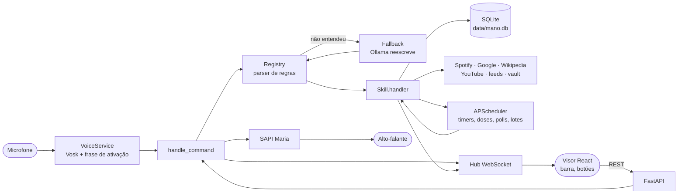

# Arquitetura

Um processo Python (FastAPI) faz tudo: voz, agendador, integrações e banco. O visor é uma página React compilada que o próprio backend serve. Nada roda na nuvem.



## Pastas

```
backend/
  mano/
    __main__.py        python -m mano → uvicorn
    main.py            create_app(): monta Ctx, registra skills, rotas do núcleo, WebSocket, serve o visor
    config.py          Settings (MANO_* / .env)
    context.py         Ctx: o que toda skill recebe (settings, db, hub, scheduler, speaker, registry, llm)
    commands.py        handle_command(): ponto único de entrada de comandos
    db.py, models.py   SQLModel + SQLite (tabelas criadas no início)
    events.py          Hub: broadcast para todos os visores conectados
    notify.py          Notificação do Windows (winotify)
    llm.py             Cliente do Ollama (fila, prioridade, escolha de modelo)
    intents/
      registry.py      Skill, @intent, Intent, Registry, Reply
      ptbr.py          normalize(), números por extenso, durações, fuzzy match, restaurar acentos
      when.py          "amanhã às 10", "sexta", "em 20 minutos" → datetime
      fallback.py      Plano B pelo modelo local
    voice/
      service.py       Microfone, thread de escuta, earcon, liga ao handle_command
      loop.py          Máquina de estados: espera ativação → ouve → transcreve
      tts.py           SapiSpeaker (fila própria, avisa quando fala) e NullSpeaker (testes)
    skills/            Uma skill por arquivo ou pasta (ver skills.md)
  tests/
frontend/
  src/
    lib/mano.ts        useMano(): WebSocket, estado ao vivo, api()
    App.tsx            Abas (hash routing) e a Home
    pages/             Remédios, Hábitos, Notas, Briefing, Ajustes
    components/        Cards e peças do visor (PanelGrid: grade arrastável dos painéis do Início, react-grid-layout)
  public/              manifest, service worker mínimo (só para instalar como app), ícone
scripts/               start.ps1 (sobe/reinicia/fecha), mano.vbs (abre sem terminal), get-models.ps1
data/                  Dados pessoais (fora do git)
docs/
```

## O caminho de um comando

1. **Entrada.** A voz (`VoiceService._on_command`), a barra (`POST /api/command`) e o WebSocket chamam `handle_command(ctx, text, source, speak)`.
2. **Normalização.** `Registry.parse()` passa o texto por `normalize()`: minúsculas, sem acento, sem "Mano," no começo, números por extenso viram dígitos ("dez" → "10").
3. **Roteamento.** As intenções são testadas em ordem de `priority` (maior primeiro). Cada uma tem regex (`patterns`) e/ou uma função (`matcher`). A primeira que casar ganha e devolve os *slots* (grupos nomeados). O texto original vai em `slots["_raw"]` para recuperar acentos e maiúsculas.
4. **Plano B.** Se nada casar e o modelo local estiver pronto, `Fallback.rewrite()` pede ao Ollama para reescrever a frase num formato do catálogo; o resultado passa de novo pelo parser. O modelo nunca executa nada.
5. **Execução.** O handler da skill roda e devolve um `Reply(speech, display, data)`.
6. **Saída.** O comando vai para `CommandLog`, a resposta é anunciada como `reply` no WebSocket e, se `speak`, falada.

Ações proativas (remédio na hora, timer acabando, lembrete, compromisso chegando) não passam por aqui: o agendador chama a skill, que usa `ctx.alarms.ring(tipo, texto)` (`mano/alarms.py`): tela, notificação do Windows, som (winsound, no backend) e voz conforme os ajustes daquele tipo, respeitando o horário silencioso. O som contínuo para com `ctx.alarms.stop(tipo)` quando o aviso é respondido. Avisos que não são alarme (estoque baixo, briefing) usam `ctx.notify()`.

## Voz

- **Ativação:** um reconhecedor Vosk com gramática restrita às frases de ativação, com limiar de confiança (`MANO_WAKE_CONF`) e exigência de palavras seguidas. Um buffer circular guarda o áudio para aproveitar o que foi dito logo depois da ativação ("fala Mano, timer de…").
- **Comando:** um segundo reconhecedor Vosk, livre, transcreve até o silêncio ou `MANO_MAX_UTTERANCE_S`. A transcrição parcial vai para o visor (`voice.partial`).
- **Eco:** enquanto o `SapiSpeaker` tem frases na fila (mais 0,4 s), o microfone é ignorado.
- **Estados** (`idle`, `listening`, `thinking`, `speaking`) vão para o visor e animam o orbe.

## Agendador

`AsyncIOScheduler` em memória (não sobrevive a reinício; cada skill reagenda o que precisa no `start()` a partir do banco):

| Job | Frequência |
|---|---|
| Doses de remédio | a cada 20 s confere o que venceu e repete avisos |
| Timers e lembretes | um job por item, na hora exata |
| Agenda, Tarefas | polling a cada 5 min |
| Gmail | polling a cada 3 min |
| Aviso de compromisso | a cada 60 s confere a agenda e avisa N min antes |
| Virada do dia dos hábitos | 00:00 |
| Spotify "tocando agora" | a cada 5 s, só com conta conectada |
| Índice das notas | a cada 60 s (só arquivos com `mtime` novo) |
| Feeds | a cada 2 h |
| Resumos do briefing | diário às 05:00 |
| Limpeza de notícias | diária às 04:10 |
| "Bom dia" automático | diário, se configurado |
| Saúde do Ollama | a cada 60 s |

## Modelo local

`LLM` (`mano/llm.py`) fala com o Ollama por HTTP. Pontos importantes:

- **Uma geração por vez** (`asyncio.Lock`). Pedidos interativos (plano B, resumo de e-mails, teste) passam na frente do lote: o resumo das notícias espera entre um artigo e outro.
- **Cache de prompt:** no plano B o catálogo de comandos vai sempre igual no `system`, então o Ollama reaproveita o processamento entre pedidos enquanto o modelo está carregado (40 s na primeira vez, 3–4 s depois).
- **Sobe sozinho:** se o Ollama local não responde e o executável existe, roda `ollama serve` escondido.
- **Saída estruturada:** o plano B usa `format` com JSON Schema (`{"comando": "..."}`).

## Dados

SQLite em `data/mano.db`, criado no início (`SQLModel.metadata.create_all`).

| Tabela | Conteúdo |
|---|---|
| `medication`, `meddose` | Remédios e cada dose agendada (status, lembretes enviados) |
| `habit`, `habitcheck` | Hábitos e dias marcados |
| `reminder`, `timer` | Lembretes e timers |
| `commandlog` | Histórico de comandos |
| `feed`, `article` | Feeds do briefing e notícias (texto extraído, resumo, lida, salva) |
| `notes_meta`, `notes_fts` | Índice do vault (SQLite FTS5, sem acento) — criadas pelo `Vault`, não pelo SQLModel |

Configurações pequenas ficam em JSON ao lado (`notes.json`, `spotify.json`, `llm.json`, `briefing.json`, `voice.json`, `alarms.json`; sons gerados em `sounds/cache`, sons próprios em `sounds/custom`), e os tokens OAuth em `*_token.json`.

## Visor

React 19 + Vite + Tailwind 4, servido pelo FastAPI a partir de `frontend/dist`. `useMano()` mantém um WebSocket com reconexão e guarda o estado de tudo; as páginas leem desse estado e chamam `api()` para agir. Navegação por hash (`#/inicio`, `#/notas?n=...`), então o backend só precisa servir `index.html`. Para desenvolver com recarga automática, `npm run dev` (porta 5173, com proxy para o backend).
